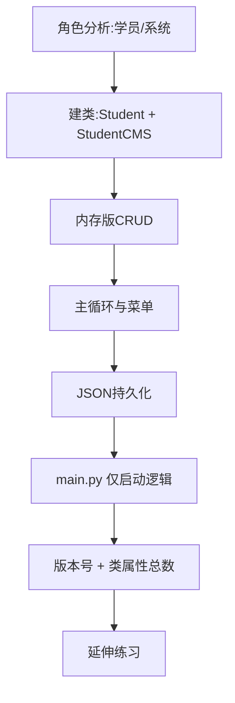

# 学生管理系统 · 开发步骤规划与进度跟踪

> 目标：以面向对象方式实现学生管理系统，满足【增删改查 + 持久化 + 全部验收标准】。
> 架构：MVC 分层 —— `student.py`(Model) / `studentCMS.py`(Controller) / `main.py`(View 启动)。

---

## 一、整体路线图

---

## 二、步骤明细

| 步骤 | 内容 | 状态 | 关键产物 / 代码落点 |
|------|------|------|----------|
| 1 | 角色拆分与文件规划 | ✅ 已完成 | `student.py` / `studentCMS.py` / `main.py` / `data/` |
| 2 | 学员类 Student（5 属性） | ✅ 已完成 | `__init__`、`show_info`、`to_dict`、`from_dict`、类属性 `count` |
| 3 | 系统类内存 CRUD | ✅ 已完成 | `add` / `find_student_by_name` / `delete` / `update` / `show` / `show_all` |
| 4 | 主循环与菜单交互 | ✅ 已完成 | `StudentCMS.run()` 的 `while` 循环、退出 `y/n` 确认、`.strip()`/`.lower()` 输入容错 |
| 5 | JSON 持久化 | ✅ 已完成 | `Student.to_dict` / `@classmethod from_dict`、`CMS.save` / `CMS.load`、`makedirs` + 空文件兜底 |
| 6 | main.py 仅启动逻辑 | ✅ 已完成 | `main.py` 仅 `import` + `StudentCMS().run()` |
| 7 | 版本号 + 类属性总数 | ✅ 已完成 | `show_menu` 打印 `v{VERSION}` 与 `当前学员总数：{Student.count}` |
| 8 | 年龄整数校验 | ✅ 已完成 | `read_int()` 公共函数，添加/修改的年龄字段复用 |
| 9 | 延伸：模糊查询（功能 7） | ✅ 已完成 | `search_by_keyword()`，按姓名/联系方式关键词匹配 |
| 10 | 延伸：类属性统计总数 | ✅ 已完成 | `Student.count`，增删时自增减 |
| 11 | 延伸：文件名构造传入 | ✅ 已完成 | `StudentCMS(filename="xxx.json")` |

---

## 三、持久化设计（已实现）

1. **Student 字典互转**
   - `to_dict(self)`：返回 `{name, age, sex, phone, note}`
   - `@classmethod from_dict(cls, d)`：用 `d.get(..., 默认值)` 防 `KeyError`，返回 `cls(...)`（不写死类名）
2. **StudentCMS.save()**
   - `os.makedirs(os.path.dirname(self.file_path), exist_ok=True)` 确保 `data/` 存在
   - `json.dump([s.to_dict() ...], f, ensure_ascii=False, indent=2)`
   - 打印 `f"已保存 {len(self.students)} 条学员信息"`
3. **StudentCMS.load()**
   - 文件不存在 → 直接返回（首次运行不报错）
   - 文件为空 / JSON 损坏 → `try/except (json.JSONDecodeError, ValueError)` 兜底空列表
   - 正常 → 逐条 `Student.from_dict` 重建并加入 `self.students`

---

## 四、验收对照（飞书原题逐条对照）

| 飞书原题要求 | 对照结果 |
|---|---|
| 要求1 程序版本信息 | ✅ `show_menu` 打印 `学生管理系统 v1.0.0` |
| 功能1 添加（5 属性） | ✅ `add_student_interactive` |
| 功能2 修改 | ✅ `update_student_interactive`，找不到提示「该学员不存在」 |
| 功能3 删除 | ✅ `delete_student`，找不到提示「该学员不存在」 |
| 功能4 查询 | ✅ `show_student`，找不到提示「该学员不存在」 |
| 功能5 显示所有 | ✅ 打印 `姓名 \| 年龄 \| 性别 \| 联系方式 \| 描述信息` |
| 功能6 保存 | ✅ `save` |
| 功能0 退出 | ✅ 带 `y/n` 确认（选 n 不退出、不丢数据；退出前自动保存） |
| 验收1 三文件职责清晰，main 仅启动 | ✅ `main.py` 仅 `import` + `StudentCMS().run()` |
| 验收2 添加保存后重启读回 | ✅ `load` 已实现（已通过冒烟测试） |
| 验收3 删除/查询不存在有提示 | ✅ |
| 验收4 文件为可读字典列表 | ✅ `to_dict` + `ensure_ascii=False` |
| 验收5 加功能不改旧方法 | ✅ 如 `search_by_keyword` 仅新增 |

---

## 五、验收清单

- [x] 三文件职责清晰，main 仅启动逻辑
- [x] 添加并保存后重启能读回（JSON 持久化闭环已验证）
- [x] 删除/查询不存在姓名不报错且有提示
- [x] 文件为可读字典列表
- [x] 新增功能只加方法不改旧方法

---

## 六、延伸练习完成度

| 延伸 | 状态 | 说明 |
|------|------|------|
| 年龄输入校验 | ✅ 已完成 | `read_int()` 抽成公共函数，挡掉 `int("abc")` 崩溃 |
| 模糊查询（功能 7） | ✅ 已完成 | `search_by_keyword()` |
| 类属性统计总数 | ✅ 已完成 | `Student.count`，菜单展示 |
| 文件名传入 | ✅ 已完成 | `StudentCMS(filename=...)` |
| CSV 互转（存储解耦） | ⬜ 选做 | 可再扩展 `save_csv/load_csv` 体会解耦 |

---

## 七、已知限制与后续可扩展

- **同名冲突**：`find_student_by_name` 只返回第一个，两个「张三」时删/改只动第一个。
  若要支持同名多人，只需修改 `find_student_by_name` 一处（改为返回列表或按序号选择），
  符合「新增功能不改旧方法」的设计原则。
- **学号查找**：若以后支持按学号查找，改动落在 `Student` 加字段 + `find_student_by_id` 新方法和菜单分支，
  已有方法无需改动。
